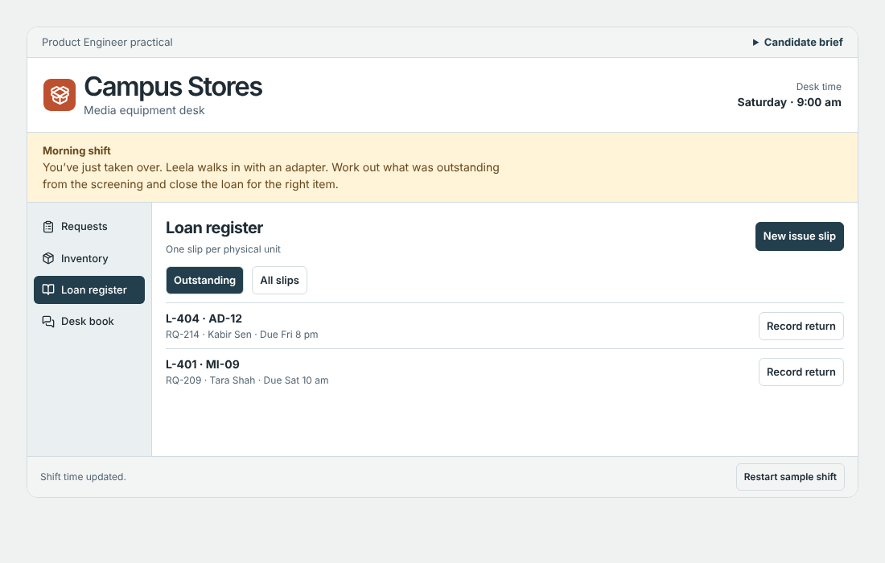
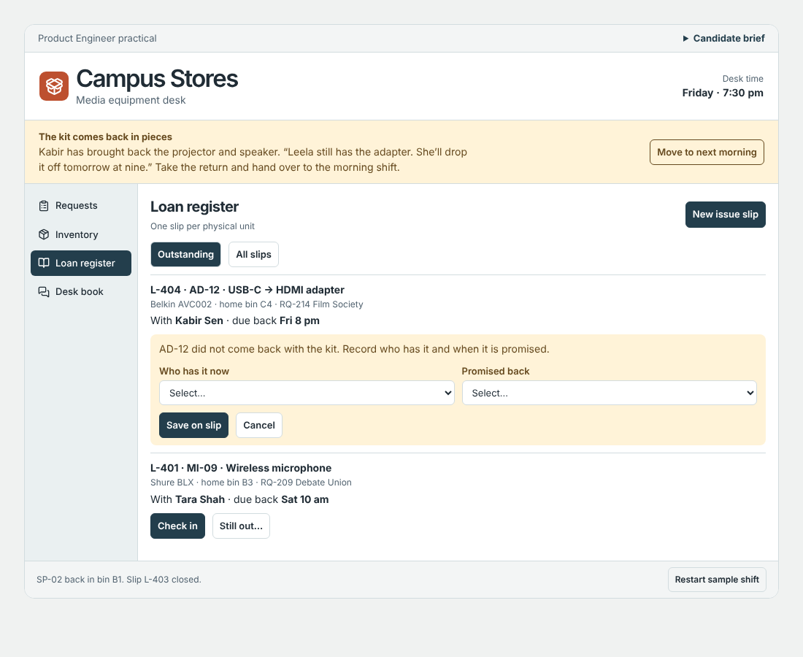
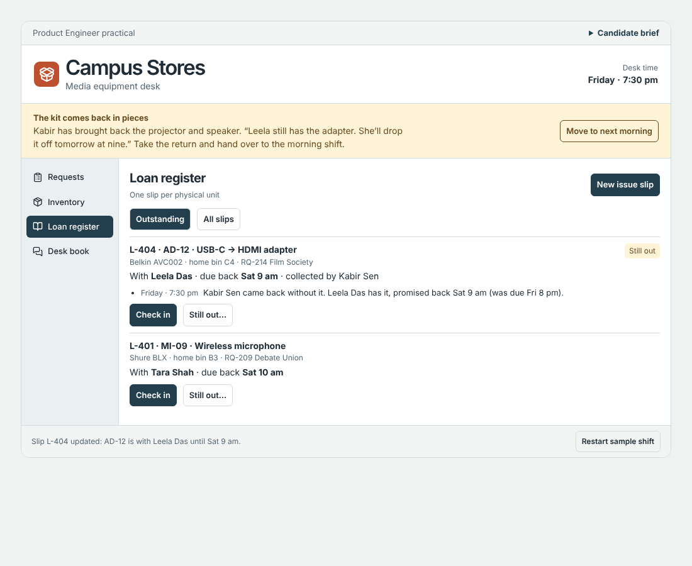
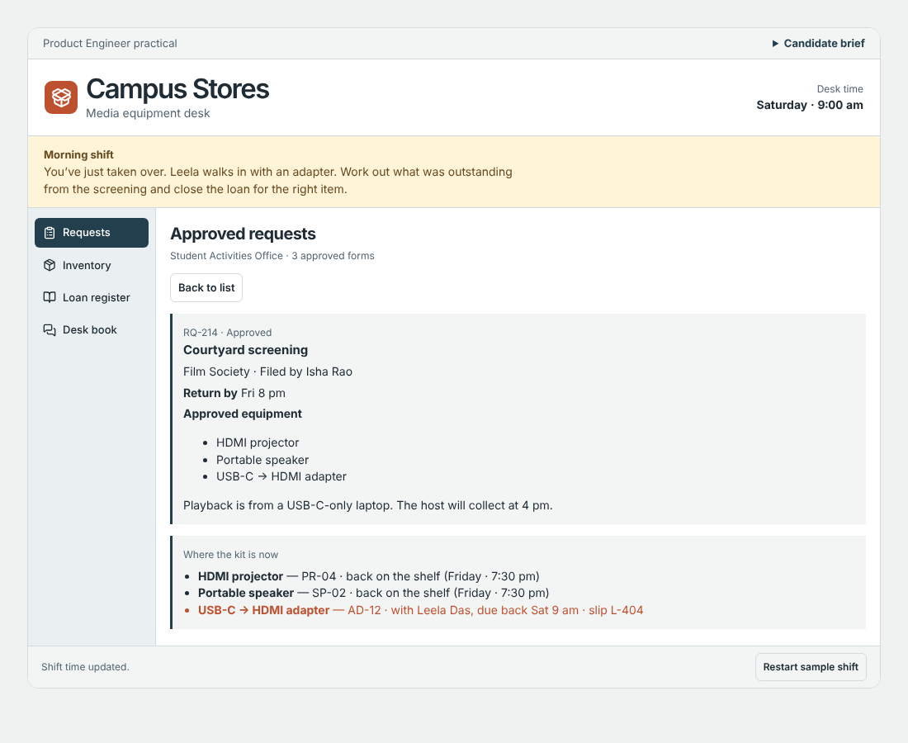
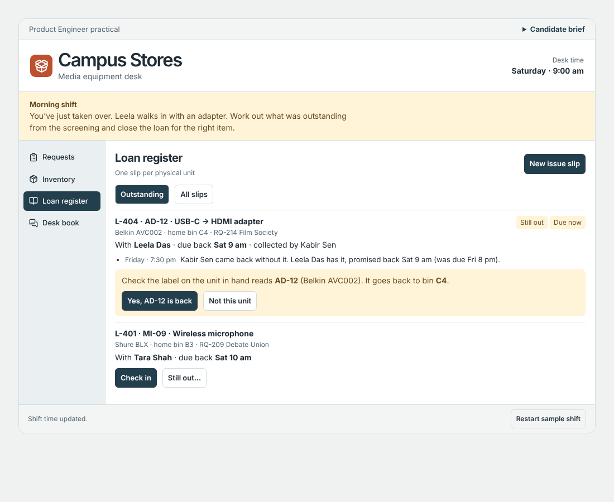

# Campus Stores — my submission

**Reviewers, start here.** My change is in `app.js` (slip tracking, check-in confirmation, request status) and `styles.css` (styles for those). Everything below explains the decision. To try it, open `index.html` and play the shift; **Restart sample shift** resets it.

---

## Would I keep this product?

Yes. The issue form is strict in the right places. But the register forgets what happens **after** an item leaves the desk, and that's exactly where this shift goes wrong.

## One moment it handles well: the issue form stops unapproved loans

At **Friday 3:45 pm**, while issuing the Film Society kit to Kabir, I tried to issue the **digital camera (CA-03)** against request **RQ-214**. The app refused: *"This equipment type is outside the approved request."* I also tried a second projector and was blocked again (*"approved quantity … already on loan"*). The projector that's in repair (PR-06) never appeared as an option at all.

That matters because pickup is the rushed moment: the film starts at four and someone is waiting at the counter. The form checks things against the approved request so the desk worker doesn't have to remember them. **I kept this exactly as it was.**

## One moment I would change: the partial return at 7:30 pm

At **Friday 7:30 pm**, Kabir returned the projector and speaker and said *"Leela still has the adapter. She'll drop it off tomorrow at nine."*

The register could only record that something came back. For the adapter, the one item that *didn't* come back, there was no way to record what I'd just been told. Slip **L-404** kept saying *"Kabir Sen · Due Fri 8 pm"*. The only place I could put "Leela has it until Sat 9 am" was a free-text note in the Desk book, with no link to the slip.

On **Saturday 9:00 am**, as the incoming shift, this is what I saw:



To close the right loan, the new worker has to:
1. Read the Desk book to learn that Leela is involved at all. Her name appears nowhere in the register.
2. Open Inventory to find out what "AD-12" is, and that it's a Belkin rather than the Anker AD-15 from the same bin.
3. Click **Record return** on the right row. There's no confirmation and no undo. Tara's microphone (L-401) sits right below it and isn't due until 10 am.

The facts needed for the next shift existed, but they were spread across three pages and depended on someone remembering to write a note. That goes against the brief's goal: *"leave the next shift enough information to finish the job."*

## What I built

The fix stores the information on the **slip itself**, which is the record the morning shift is already looking at.

1. **"Still out…" on every open slip.** It records who has the unit now and when it's promised back. The slip updates its holder and due time, and keeps a dated line in its history: *"Kabir Sen came back without it. Leela Das has it, promised back Sat 9 am (was due Fri 8 pm)."*
2. **Slips you can read without looking anything up.** Each slip shows the item type, model, home bin and club, who has it now, a **Still out** tag, and a **Due now / Overdue** tag based on the desk clock.
3. **Check in asks you to confirm the unit first.** *"Check the label on the unit in hand reads AD-12 (Belkin AVC002). It goes back to bin C4."* Then **Yes, AD-12 is back** or **Not this unit**.
4. **"Where the kit is now" on the request.** Opening RQ-214 shows each approved item as back on the shelf, still out (with whom and until when), or not issued yet. The Requests list flags *"1 still out"*.

## The same shift, with my version

**Friday 3:45 pm, pickup.** Unchanged. I issue PR-04, SP-02 and AD-12 to Kabir, due Fri 8 pm. The form still blocks the camera.

**Friday 7:30 pm, return.** I click **Check in** on the projector and speaker, confirm each label, and they close. On the adapter slip I click **Still out…** and choose *Leela Das* and *Sat 9 am*.





**Saturday 9:00 am, morning shift.** Leela walks in. The register already shows *"With Leela Das · due back Sat 9 am"* with **Still out** and **Due now** tags. If I start from the request instead, RQ-214 shows exactly one item outstanding:



I click **Check in** on L-404, check the label against *AD-12 (Belkin AVC002)*, and confirm. It goes back to bin C4. Tara's microphone is untouched.



I didn't need the Desk book or Inventory to finish the job.

## What I kept on purpose

- **The issue form and its checks** (approved type, approved quantity, nothing in repair). This is the part that works well.
- **One slip per physical unit.** It's what makes the AD-12 vs AD-15 check possible.
- **The Desk book.** It's still the place for conversation and context. It just no longer has to carry facts that belong on a slip.
- **The layout, navigation and saved-state format.** New fields are optional, so a shift saved by the original version still loads.

## How I'd know it helped at a real counter

I'd watch the **first ten minutes of a morning shift** when an item from yesterday comes back late. Without my change, the worker usually opens the Desk book or asks a colleague before closing the slip. With it, they should go straight from the register to the right slip.

The signal: **how often the incoming worker closes the correct slip without opening the Desk book or asking anyone.** A secondary signal is wrong-slip closures, which show up as items marked "on shelf" that aren't.

## What I'd do next (not built)

- Pre-fill **Return by** and **Collected by** on the issue form from the request and the Desk book delegation, and warn when they differ.
- Issue a whole approved request in one step instead of three separate slips.
- Put the form's error messages next to the form instead of in the status bar at the bottom.

---

## Run the app

Open `index.html` in a modern browser. It runs offline. Or serve it locally and visit `http://localhost:8000`:

```sh
python3 -m http.server 8000 --bind 127.0.0.1
```

## Source

- `index.html`: desk layout, candidate brief, bundled icons.
- `app.js`: sample records and interactions (includes my changes).
- `styles.css`: desktop and mobile layouts (includes my changes).
- `docs/`: screenshots used in this README.

Icon license notices are in [third-party/lucide-LICENSE.txt](third-party/lucide-LICENSE.txt).
